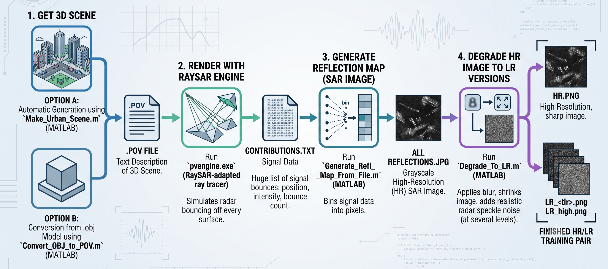
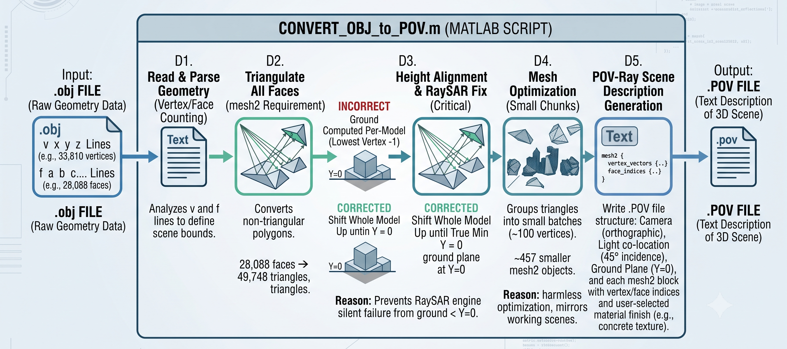

# SAR Image Super-Resolution via GAN, trained on a RaySAR-simulated dataset

Final Year Project: enhance low-resolution Synthetic Aperture Radar (SAR) images to high resolution using a GAN (SRGAN/ESRGAN-style generator/discriminator).

Real matched HR/LR SAR image pairs of the same scene essentially don't exist publicly — high-resolution SAR archives are mostly restricted/commercial, and no two captures of one place at both high and low resolution under identical conditions are freely available. This project works around that by generating its own paired dataset with [RaySAR](https://github.com/StefanJAuer/RaySAR.git), a ray-tracing-based 3D SAR simulator: render a scene once for a clean "HR" image, then synthetically degrade it (blur + downsample + realistic speckle noise) to produce the matching "LR" image. Both images originate from the same simulation, so they're pixel-aligned by construction — exactly what supervised training needs.

**This repository is the dataset-creation pipeline for the main FYP project** — it covers everything up to producing the HR/LR training pairs. GAN model training/evaluation on top of this dataset is the next phase (not yet started — see Status at the bottom).

## Start here

**→ [`RaySAR_Workspace/README.md`](RaySAR_Workspace/README.md) — the actual pipeline: setup, usage, and known gotchas.**

`RaySAR_Workspace/` is fully self-contained (the ray-tracing engine, its support library, and RaySAR's MATLAB code are all bundled inside it) and is the only folder published to this project's GitHub repo. Everything else in this local folder — the original vendor package, source 3D models, proposal/meeting docs — is local working context that supports it but isn't part of the published pipeline. Everything below this section is that context, for how the pipeline fits into the FYP as a whole.

## Project goal and dataset requirements

Per supervisor guidance (Adeesha Wijayasiri), the dataset needs a minimum of 10 distinct scenarios (city, desert, sea, roads, moving objects, people, etc.), each with paired low/high-resolution SAR output, across multiple resolution tiers.

The project scope also covers SAR **video**, not just still images, and targets a real-time/near-real-time GPU-accelerated pipeline (PyTorch/CUDA) — worth keeping in mind if the model architecture or evaluation plan needs to account for inference speed later, not just output quality. Known challenges called out from the start: limited high-quality SAR datasets (the whole reason this pipeline exists), high GPU/compute requirements, and maintaining physical realism (speckle/scattering characteristics) rather than just optimizing for smoothness.

**A note on scenario realism:** RaySAR is a geometric ray tracer, physically validated against real building/urban SAR imagery — that's genuinely its strength. Some requested scenario types (sea/water, moving vehicles) are only approximations under this tool — see `RaySAR_Workspace/README.md` Part 8 for why, and don't let chasing physical accuracy there take time away from the building/urban scenarios where results are actually defensible.

## Overall pipeline (this project's methodology)

1. **Synthetic data generation with RaySAR** — produces high-fidelity "ground truth" SAR images with full control over scene content, incidence angle, and imaging geometry.

2. **Building LR/HR training pairs** — each RaySAR output is the HR target; synthetic degradation (downsampling, multiplicative speckle noise, mild blur) produces the matching LR input. Augmentation (random crops, rotations, flips) expands dataset diversity without needing more simulated scenes.
3. **Training the GAN** — generator learns LR→HR mapping, discriminator tells generated from real HR images apart, trained adversarially with a combined pixel-wise + adversarial loss (PyTorch, CUDA).
4. **Evaluation** — PSNR, SSIM, and a speckle-aware metric (ENL) so over-smoothing doesn't get missed by the general-purpose metrics alone.
5. **Real-data validation** — since RaySAR output is still synthetic, a small set of real SAR images (see dataset links below) serves as a sim-to-real sanity check, and optionally a fine-tuning set.

Key considerations carried over from the original methodology write-up: ray-tracing complex 3D scenes at high fidelity is computationally heavy, so dataset scale should be sized around what's realistically simulatable in the available time; and varying scene types, materials, and incidence angles reduces the risk of the model overfitting to one kind of geometry.

## Building scenes from real 3D models (.obj)

Besides procedurally-generated scenes, `Convert_OBJ_to_POV.m` turns a real Wavefront `.obj` 3D model into a RaySAR-ready scene, producing noticeably richer/more realistic geometry than hand-built procedural boxes (validated on a 33,810-vertex real street model — see `Street_01` in `RaySAR_Workspace/Scenes/`).

Full step-by-step explanation of this conversion (including the two bugs found and fixed) is in `RaySAR_Workspace/README.md` Part 6.

## Supplementary real SAR datasets

Since a purely-simulated dataset has an inherent sim-to-real gap, these are free sources of real SAR imagery to validate against or blend in (treat as HR ground truth, degrade with the same pipeline script):

- [Capella Space Open Data](https://registry.opendata.aws/capella_opendata/) (CC BY 4.0, high resolution)
- [Umbra Open Data](https://umbra.space/open-data/) (up to 16cm resolution)
- [ICEYE Open Dataset](https://registry.opendata.aws/iceye-opendata/)
- [ASF Vertex](https://search.asf.alaska.edu/) (Sentinel-1 archive, free, lower resolution)
- Kaggle: [HRSID](https://www.kaggle.com/datasets/sarribere99/high-resolution-sar-images-dataset-hrsid), [SARscope](https://www.kaggle.com/datasets/kailaspsudheer/sarscope-unveiling-the-maritime-landscape), [SAR-Ship-Dataset](https://www.kaggle.com/datasets/kmader/sarshipdataset)

## Supervisor meeting record — 2026-07-13

Full notes from the first supervisor meeting, kept here since this is the source of the project's direction and the dataset requirements above.

**Key outcomes:** the project goal is to enhance low-resolution SAR images to high resolution using machine learning/generative AI. The 3D SAR simulator (RaySAR) was selected as the primary data source since real radar footage is scarce due to security restrictions. The student is responsible for getting the simulator operational and building an initial labeled dataset before any super-resolution work begins.

**Decisions made:**
- Primary tool: use RaySAR (the "3DSAR" simulator) exclusively — no need to evaluate multiple simulators, since the choice of simulator doesn't change the underlying output.
- Dataset structure: generate paired low-resolution and high-resolution SAR images from the *same* scenes to create a labeled training dataset.
- Resolution tiers: dataset should include multiple resolution levels (lowest → mid → improved → highest).
- Super-resolution approach: explore multiple methods including generative AI; compare results across methods to identify the best performer.

**Identified risks:**
- Real-world radar video footage is extremely rare due to security restrictions, making the simulator the only viable data source.
- No capability to conduct physical radar transmission/reception (no drone or flight platform available).

**Pending confirmation (at the time):** specific ML/super-resolution algorithms to be finalized after the dataset is ready; proposal document to be drafted once project direction was confirmed.

**Action items given to the student:**
- Download and run the RaySAR simulator; confirm it is operational. *(Done — see status below.)*
- Create a minimum of 10 test scenarios (e.g., sea, desert, city, roads, moving objects, people, cars).
- Review simulator documentation to understand supported object file formats.
- Generate both low-resolution and high-resolution outputs per scenario to build the labeled dataset.
- Report progress to Adeesha at the next weekly meeting.

## Key references

**SAR simulation**
- S. Auer, S. Hinz, R. Bamler, "Ray-tracing simulation techniques for understanding high-resolution SAR images," IEEE TGRS, vol. 48, no. 3, pp. 1445–1456, 2010. https://doi.org/10.1109/TGRS.2009.2029339
- S. Auer, R. Bamler, P. Reinartz, "RaySAR - 3D SAR simulator: Now open source," Proc. IEEE IGARSS, pp. 6730–6733, 2016. https://ieeexplore.ieee.org/document/7730757/
- RaySAR open-source repository (StefanJAuer/RaySAR). https://github.com/StefanJAuer/RaySAR
- Learning Surface Scattering Parameters From SAR Images Using Differentiable Ray Tracing, arXiv, 2024. https://arxiv.org/html/2401.01175v1

**GAN-based super-resolution architectures**
- C. Ledig et al., "Photo-realistic single image super-resolution using a generative adversarial network" (SRGAN), CVPR, 2017. https://arxiv.org/abs/1609.04802
- X. Wang et al., "ESRGAN: Enhanced super-resolution generative adversarial networks," ECCV Workshops, 2018. https://arxiv.org/abs/1809.00219

**Evaluation metrics**
- Z. Wang, A. C. Bovik, H. R. Sheikh, E. P. Simoncelli, "Image quality assessment: From error visibility to structural similarity" (SSIM), IEEE TIP, vol. 13, no. 4, pp. 600–612, 2004. https://ece.uwaterloo.ca/~z70wang/publications/ssim.html
- Equivalent Number of Looks (ENL) — definition and calculation, Sentinel-1 Normalised Radar Backscatter documentation. https://s1-nrb.readthedocs.io/en/v1.6.0/general/enl.html

**Related SAR super-resolution research**
- C. Zhang et al., "Blind super-resolution for SAR images with speckle noise based on deep learning probabilistic degradation model and SAR priors," Remote Sensing, vol. 15, no. 2, p. 330, 2023. https://www.mdpi.com/2072-4292/15/2/330
- "DMSC-GAN: A c-GAN-based framework for super-resolution reconstruction of SAR images," Remote Sensing, vol. 16, no. 1, p. 50, 2024. https://www.mdpi.com/2072-4292/16/1/50
- "SAR image super-resolution with integrated speckle suppression via generative adversarial network," IEEE Xplore, 2025. https://ieeexplore.ieee.org/document/11153036/
- "Lightweight super-resolution generative adversarial network for SAR images," Remote Sensing, vol. 16, no. 10, p. 1788, 2024. https://www.mdpi.com/2072-4292/16/10/1788
- Image Generation and Super-Resolution Reconstruction of SAR Images Based on an Improved Single-Image GAN, Information, 2025. https://doi.org/10.3390/info16050370
- SAR Super-Resolution Imaging and Recognition Integrated Network Based on Deep Learning Framework, IEEE, 2025. https://ieeexplore.ieee.org/document/11071996/
- Video SAR Enhanced Imaging Using a Self-Supervised Super-Resolution Reconstruction Network, Remote Sensing, 2026. https://www.mdpi.com/2072-4292/18/5/670
- "Generative artificial intelligence meets synthetic aperture radar: A survey," arXiv:2411.05027, 2024. https://arxiv.org/html/2411.05027v1
- Deep learning for artificial SAR image generation: Generative AI for SAR (survey chapter). https://www.sciencedirect.com/science/article/abs/pii/B978044336344300009X

**Sim-to-real / hybrid dataset training (supports this project's synthetic + real data strategy)**
- Single-Domain Generalization via Multilevel Data Augmentation for SAR Target Recognition Training on Fully Simulated Data, Remote Sensing, 2025. https://doi.org/10.3390/rs17172966
- Training Deep Learning Models with Hybrid Datasets for Robust Automatic Target Detection on real SAR images, arXiv, 2024. https://arxiv.org/pdf/2405.09588

## Status

- RaySAR simulation pipeline: **built and validated** (output matched DLR's own reference results exactly for the official Step test model).
- Procedural scene generation (box buildings, dense urban blocks with streets/cars): **working**, two example scenarios generated (`City_01`, `Urban_01`).
- Real 3D model (.obj) import: **working**, validated on a 33,810-vertex real street environment model (`Street_01`).
- LR degradation (blur + downsample + speckle, multiple tiers): **working**.
- GAN training: not yet started — dataset generation is the current phase.
