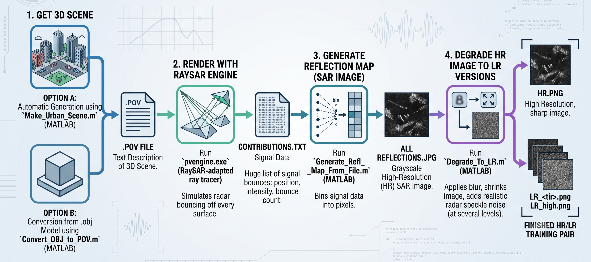

# RaySAR SAR Super-Resolution Dataset Pipeline

A self-contained, working pipeline that generates synthetic SAR (Synthetic Aperture Radar) image datasets for training a super-resolution model — built for an FYP on enhancing low-resolution SAR images to high resolution using a GAN. Real matched HR/LR SAR image pairs of the same scene don't exist publicly, so this pipeline generates them synthetically: build a 3D scene, ray-trace it into a radar image, then synthetically degrade that image into matching low-resolution versions.

Everything needed to run it is already inside this folder — the RaySAR-adapted ray-tracing engine, its support library, RaySAR's own MATLAB code, and the custom scripts written on top of it. The only thing you need to install yourself is MATLAB.

---

## Part 1 — How the pipeline works

Four stages, each one a real, separate program run:

```
STAGE 1            STAGE 2              STAGE 3                  STAGE 4
Build a 3D    -->   Ray-trace it    -->  Turn the radar     -->   Synthetically
scene (.pov)        (pvengine.exe)       signal data into         degrade the HR
                     produces             an HR grayscale          image into
                     Contributions.txt    SAR image (MATLAB)       several LR
                                                                    versions (MATLAB)
```



**Stage 1 — Build a 3D scene.** A `.pov` file is a plain-text description of a 3D scene in POV-Ray's own language: camera, light, ground, and objects (buildings, streets, cars, or an imported real 3D model). You either write one by hand, generate one with a MATLAB script in `Scripts/`, or convert a `.obj` 3D model file into one.

**Stage 2 — Ray-trace it.** `pvengine.exe` (a modified build of POV-Ray, created for the RaySAR project) reads the `.pov` file and simulates how radar signals would bounce off every surface in the scene — direct hits, ground bounces, double/triple/multi-bounce reflections off corners, all of it. It writes every single signal contribution — its position, intensity, and how many bounces it took — into a plain text file called `Contributions.txt`.

**Stage 3 — Build the HR image.** `Contributions.txt` is just a huge list of numbers, not an image. A MATLAB function (`Gen_Refl_Map`, from RaySAR's own code, driven by `Generate_Refl_Map_From_File.m`) bins all those signal contributions into pixels based on their position, sums up the signal in each pixel, and produces the actual grayscale SAR image — this is your "HR" (high-resolution) ground-truth image.

**Stage 4 — Degrade to LR.** A real low-resolution SAR capture isn't just a shrunk version of a high-resolution one — it's blurrier and has more speckle noise (radar's characteristic grainy texture). `Degrade_To_LR.m` takes the HR image and applies: a mild blur, downsampling by some factor, and realistic multiplicative speckle noise (the same statistical model — averaged independent-look exponential noise — that real SAR speckle follows). It does this at several different severity "tiers," giving you multiple LR versions per HR image.

The result of running all four stages once: one `HR.png` and several `LR_<tier>.png` files, pixel-aligned, ready to be a training pair.

---

## Part 2 — What's already in this folder

```
POV_Ray/
  RaySAR/pvengine.exe    The RaySAR-adapted ray-tracing engine. This is the one that
                         actually understands the SAR_Output_Data scene keyword and
                         produces Contributions.txt. This is the engine you run.
  POV_reg/pvengine.exe    An unmodified stock POV-Ray engine, kept only for reference/comparison
                         -- you never need to run this one.
  include/               POV-Ray's standard scene-description library (colors.inc, finish.inc,
                         etc.) that every .pov file needs. Bundled here so no separate download
                         or install step is needed.
RaySAR/                  RaySAR's own MATLAB code (Gen_Refl_Map.m, R_Map.m, and everything else
                         RaySAR ships with) -- this is what actually turns Contributions.txt into
                         an image. Not modified, just vendored here so it's on the MATLAB path.
Scripts/                 The custom pipeline scripts written for this project (see Part 5).
Scenes/                  Example scenes with their full generated output, showing what a
                         finished result looks like (City_01, Urban_01, Street_01).
Test_Runs/               The two official RaySAR reference test models (Box, Step) plus their
                         results -- use these to verify a fresh setup is working correctly.
```

Because the engine, its library, and RaySAR's MATLAB code are all already here, **you do not need to download the original RaySAR package to run this pipeline.** You'd only need it if you want RaySAR's official documentation/PDFs, or its bundled test models beyond what's already copied into `Test_Runs/` — get it from [github.com/StefanJAuer/RaySAR](https://github.com/StefanJAuer/RaySAR.git) if so.

---

## Part 3 — Prerequisites

- **MATLAB.** No toolboxes required — every script here deliberately avoids the Image Processing and Statistics toolboxes, so this works on a bare MATLAB install. (Check what you have with `ver` at the MATLAB prompt. If your license says "Trial," be aware it will eventually expire.)
- **Windows.** The bundled `pvengine.exe` is a Windows binary. (A Linux build of the adapted engine exists in the original RaySAR package if you need it, but this repo's setup is Windows-only as-is.)
- That's it. POV-Ray does **not** need to be separately installed system-wide — see Part 4.

---

## Part 4 — Full execution walkthrough (from a fresh clone)

This walks through generating one complete HR/LR pair from scratch, explaining what each command does.

### Step 0: locate MATLAB and this folder

Note your MATLAB install path (e.g. `C:\Program Files\MATLAB\R2024a\bin\matlab.exe` or wherever yours is) and the path you cloned this repo to. The rest of this guide assumes you're running commands from inside the cloned folder (referred to below as `.`).

### Step 1: verify the engine runs at all

Render the bundled official test scene:

```powershell
cd .\POV_Ray\RaySAR
.\pvengine.exe /EXIT +I"..\..\Test_Runs\Step.pov" +W1000 +H1200 +L"..\include"
```

- `/EXIT` — close the engine automatically once done (needed for non-interactive use; without it, the GUI window stays open).
- `+I"..."` — the input scene file.
- `+W`/`+H` — output image width/height in pixels.
- `+L"..."` — path to the include library (already bundled at `POV_Ray/include`).

This should complete in a few seconds and produce **`Test_Runs\Step.png`** (a preview image) and **`POV_Ray\RaySAR\Contributions.txt`** (the actual SAR signal data — this is the important output, the PNG is just a visual sanity check). If both files appear, your setup works. If nothing appears, see the Troubleshooting section (Part 6) — this exact failure mode (silent, no error) has a known cause.

### Step 2: turn Contributions.txt into an HR image

Back in MATLAB:

```matlab
cd('path/to/this/repo')
addpath('RaySAR')
addpath('Scripts')

opts.a_pix = 0.2; opts.r_pix = 0.2;
opts.a_min = '-15'; opts.a_max = '15';
opts.r_min = '62';  opts.r_max = '137';
opts.range_dir = 1;

Generate_Refl_Map_From_File('POV_Ray/RaySAR/Contributions.txt', 'Test_Runs/Step_Results', opts);
```

This calls RaySAR's own `Gen_Refl_Map` function under the hood. It reads `Contributions.txt`, bins every signal contribution into pixels, and writes the HR image out to:

```
Test_Runs/Step_Results/Maps/Figures/Ref_Maps/JPG/All Reflections.jpg   <- this is your HR image
Test_Runs/Step_Results/Maps/Figures/Ref_Maps/JPG/Single Bounce.jpg     <- individual bounce-level layers
Test_Runs/Step_Results/Maps/Figures/Ref_Maps/JPG/Double Bounce.jpg
```

(The specific `a_min`/`a_max`/`r_min`/`r_max`/pixel-spacing numbers above are the documented parameters for this particular Step test scene. For your own scenes, you generally don't need to know these in advance — see Step 4.)

Compare your `All Reflections.jpg` against `Test_Runs/Step_Results` — if you re-ran Step 2 on a fresh setup, it should match what's already checked into this repo.

### Step 3: degrade the HR image into LR training pairs

Still in MATLAB:

```matlab
hr_path = 'Test_Runs/Step_Results/Maps/Figures/Ref_Maps/JPG/All Reflections.jpg';

tiers(1) = struct('name','mid',  'scale',2, 'looks',4, 'blur_sigma',0.6);
tiers(2) = struct('name','low',  'scale',4, 'looks',2, 'blur_sigma',1.2);
tiers(3) = struct('name','vlow', 'scale',8, 'looks',1, 'blur_sigma',2.0);

Degrade_To_LR(hr_path, 'Test_Runs/Step_LR_Pairs', tiers);
```

Each `tiers` entry is one severity level: `scale` is the downsampling factor, `looks` controls how noisy the speckle is (lower = noisier — 1 look is the noisiest, most realistic single-look SAR speckle), `blur_sigma` is how much blur to apply before downsampling. You can add more tiers or change these numbers freely.

Output in `Test_Runs/Step_LR_Pairs/`:
```
HR.png                 the (recompressed) HR reference
LR_mid_native.png       actually downsampled to half size
LR_mid_aligned.png      the same image upsampled back to HR's pixel size (for pixel-aligned pairs)
LR_low_native.png / LR_low_aligned.png       (quarter size)
LR_vlow_native.png / LR_vlow_aligned.png     (eighth size, single-look noise)
```

**That's the whole pipeline.** Steps 1-3 are exactly what you repeat for every new scene — the only thing that changes is the scene file itself and the numeric parameters in Step 2.

### Step 4: do it again with a scene you generate yourself, at scale

Rather than hand-writing `.pov` files and guessing bounds, use the provided generators. Full worked example already in this repo — open `Scripts/run_urban01_pipeline.m` and `Scripts/gen_urban01.m` side by side; they do exactly Steps 1-3 above, scripted, for the bundled `Urban_01` scene. To make your own:

```matlab
addpath('Scripts')
opts.seed = 42;                                 % change this for a different layout/"place"
opts.grid_rows = 4; opts.grid_cols = 4;
Make_Urban_Scene('Scenes/MyCity.pov', opts);
```

Then render it exactly like Step 1 (swap in `Scenes/MyCity.pov` as the `+I` argument, pick your own `+W`/`+H`), then run Steps 2-3 — except for a new scene you don't know good `a_min`/`a_max`/`r_min`/`r_max` values in advance, so use `'Min'`/`'Max'` (auto-fit) instead of specific numbers:

```matlab
opts.a_pix = 0.3; opts.r_pix = 0.3; opts.range_dir = 1;
opts.a_min = 'Min'; opts.a_max = 'Max'; opts.r_min = 'Min'; opts.r_max = 'Max';
Generate_Refl_Map_From_File('POV_Ray/RaySAR/Contributions.txt', 'Scenes/MyCity_Results', opts);
```

---

## Part 5 — Script reference

| Script | Purpose |
|---|---|
| `Make_Box_City_Scene.m` | Simple procedural scene: isolated box buildings at given positions/sizes. Superseded by `Make_Urban_Scene.m` — kept as the simpler starting example. |
| `Make_Urban_Scene.m` | The real procedural generator: a jittered grid of buildings with random rotation, some L-shaped, plus streets and scattered cars. Pass a different `seed` for a different layout. **Use this one for new procedural scenes.** |
| `Convert_OBJ_to_POV.m` | Converts a Wavefront `.obj` 3D model into a RaySAR-ready `.pov` scene (via POV-Ray's `mesh2` primitive). Use this to get real building/street geometry instead of procedural boxes — see `Scenes/Street_01.pov` for a worked example (converted from a 33,810-vertex real street model). |
| `Generate_Refl_Map_From_File.m` | Stage 3: turns a `Contributions.txt` into the HR reflectivity map image(s). Generalized wrapper around RaySAR's own `Gen_Refl_Map.m` so you don't have to drive the interactive GUI. |
| `Degrade_To_LR.m` | Stage 4: turns one HR image into several LR tiers (blur + downsample + speckle noise). Toolbox-free (works on bare MATLAB). |
| `run_city01_pipeline.m`, `run_urban01_pipeline.m`, `run_street01_pipeline.m` | Full worked examples, Stages 3-4 wired together, for each of the three example scenes already in `Scenes/`. Copy one of these as your starting template for a new scene. |
| `gen_city01.m`, `gen_urban01.m`, `convert_street01.m` | The Stage-1 scene-generation calls that produced the three example scenes. |

---

## Part 6 — Troubleshooting / gotchas (read this before you burn hours debugging)

1. **Render silently produces nothing (no `.png`, no `Contributions.txt`, no error dialog, exit code 0).** The single most common cause: your scene's ground plane is at a negative Y coordinate. The RaySAR-adapted engine appears to hard-require ground at Y≥0 with all geometry at Y≥0 (every official RaySAR test scene follows this convention) — it doesn't just look wrong, it silently fails to produce any output at all. `Convert_OBJ_to_POV.m` already handles this automatically (shifts the whole model so its minimum Y is 0); if you hand-write a `.pov` file or write your own generator, keep ground at exactly `0`.
2. **Auto-fit (`'Min'`/`'Max'`) image bounds produce a mostly-black image with real content crammed in a tiny corner.** This happens with large/imported meshes that produce a handful of stray, far-outlying signal contributions (seen with the 33k-vertex Street model — auto-fit produced an 11,000×7,000 pixel image that was 99% empty). Fix: compute robust bounds yourself instead of trusting auto-fit — sort the loaded azimuth/range values and take the 0.5th/99.5th percentile, then pass those as explicit numeric strings in `opts.a_min`/`a_max`/`r_min`/`r_max`. See `run_street01_pipeline.m` for the exact working code (no toolbox needed, just `sort()`).
3. **`run('_myscript.m')` fails with "Invalid text character."** MATLAB script filenames can't start with an underscore — `_foo` isn't a valid MATLAB identifier, and this is the (cryptic) error you get. Start script names with a letter.
4. **Don't reach for `imresize`, `imgaussfilt`, or `gamrnd`.** This repo assumes no Image Processing or Statistics toolbox. `Degrade_To_LR.m` uses `interp2` for resizing, a hand-built Gaussian kernel with `conv2` for blur, and sums of `-log(rand())` (Exponential draws) to build L-look Gamma-distributed speckle — all core MATLAB. If you do have those toolboxes, feel free to swap in the faster built-ins, but don't assume they're available.
5. **A mesh2 object with too many objects/vertices at once used to look like the problem, but wasn't.** If you're extending `Convert_OBJ_to_POV.m` and something seems to break again at scale, check the ground-plane Y value first (#1) before assuming it's a vertex/object count limit — that was a red herring the first time around.

---

## Part 7 — Scenario realism notes

RaySAR is a geometric ray tracer, physically validated against real building/urban SAR imagery — that's genuinely its strength, and city/urban-type scenes here are on solid ground. Two scenario types are only approximations under this tool, worth knowing if your project needs them too:

- **Sea/water:** a flat reflective plane does not reproduce real ocean SAR backscatter, which comes from Bragg scattering off centimeter-scale wind-driven roughness — a statistical phenomenon this ray tracer doesn't model. Treat a "sea" scene as stylized, not physically faithful.
- **Moving objects (cars, people):** RaySAR is a single-snapshot ray tracer with no Doppler/motion-blur model. Placing a car/person is geometrically fine as a static object, but "moving" artifacts (the actual SAR signature of movers) would need to be added separately in post-processing.

---

## Part 8 — Supplementing with real SAR data

A purely-simulated dataset has an inherent sim-to-real gap. These are free sources of real SAR imagery — use one as your "HR" image (skip Stages 1-3 entirely) and run it straight through `Degrade_To_LR.m`:

- [Capella Space Open Data](https://registry.opendata.aws/capella_opendata/) — free, CC BY 4.0, high resolution
- [Umbra Open Data](https://umbra.space/open-data/) — free, up to 16cm resolution
- [ICEYE Open Dataset](https://registry.opendata.aws/iceye-opendata/) — free curated high-resolution SAR
- [ASF Vertex](https://search.asf.alaska.edu/) — free Sentinel-1 archive (lower resolution, ~5-20m, but huge and well documented)
- Kaggle: [HRSID](https://www.kaggle.com/datasets/sarribere99/high-resolution-sar-images-dataset-hrsid), [SARscope](https://www.kaggle.com/datasets/kailaspsudheer/sarscope-unveiling-the-maritime-landscape), [SAR-Ship-Dataset](https://www.kaggle.com/datasets/kmader/sarshipdataset)

Pick the "detected"/amplitude product form (not raw complex/SLC) — that's a plain grayscale image, same as RaySAR's own output, so it plugs straight into `Degrade_To_LR.m`.

---

## Part 9 — References

- S. Auer, S. Hinz, R. Bamler, "Ray-tracing simulation techniques for understanding high-resolution SAR images," IEEE TGRS, 2010.
- S. Auer, R. Bamler, P. Reinartz, "RaySAR - 3D SAR simulator: Now open source," IGARSS, 2016.
- RaySAR source: [github.com/StefanJAuer/RaySAR](https://github.com/StefanJAuer/RaySAR.git)
- C. Ledig et al., "Photo-realistic single image super-resolution using a generative adversarial network" (SRGAN), CVPR, 2017.
- X. Wang et al., "ESRGAN: Enhanced super-resolution generative adversarial networks," ECCV Workshops, 2018.
- Z. Wang et al., "Image quality assessment: From error visibility to structural similarity" (SSIM), IEEE TIP, 2004.
