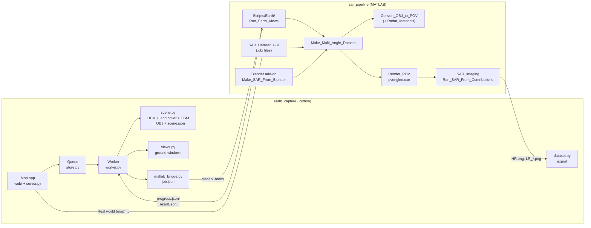

# Architecture

## Folders

```
TerraBound-SAR/
├── README.md, LICENSE, THIRD_PARTY_NOTICES.md, DATA_LICENSE.md, CITATION.cff
├── docs/                    the documentation (this folder)
├── earth_capture/           Earth Capture: real-world scenes from open data (Python 3.10+)
│   ├── install.ps1, Earth Capture.bat, requirements.txt, pyproject.toml
│   ├── terrabound_earth/    the package (see below)
│   └── tests/               offline tests (pytest)
└── sar_pipeline/            the SAR simulation and imaging pipeline (MATLAB + the RaySAR engine)
    ├── Scripts/             scene conversion, views, rendering, the dataset driver, the GUIs
    │   ├── Earth/           Run_Earth_Views: the entry point Earth Capture calls
    │   └── Sample_Scenes/   how each bundled sample scene was made
    ├── SAR_Imaging/         the radar signal chain: raw data, backprojection, HR/LR pairs
    ├── RaySAR/              RaySAR 1.2 (S. Auer, DLR), AGPL v3, with the changes in raysar_modifications.md
    ├── POV_Ray/             the RaySAR build of POV-Ray (pvengine.exe) and its include files
    ├── Blender/             the SAR View Picker add-on
    ├── Scenes/              sample scenes (.pov) and their previews
    └── Test_Runs/           RaySAR's Box and Step reference scenes
```

Generated folders, not in git:
- `runs/`: one folder per captured area.
- `datasets/`: exported datasets.
- `earth_capture/.cache/`: downloaded data.
- `earth_capture/.venv/`: the Python environment.

## How the parts work together



Every way of making images ends in the same function, `Make_Multi_Angle_Dataset`:
- a hand-made `.obj` in the SAR Dataset GUI;
- views placed in Blender;
- a real-world area from Earth Capture.

The SAR method is therefore the same whichever way a scene was made:

1. Conversion to POV-Ray.
2. Ray tracing with the RaySAR engine.
3. Contributions to scatterers.
4. Raw radar data.
5. Backprojection.
6. HR and LR images formed from the full and the partial raw data.

## Earth Capture modules

| Module | Does |
|---|---|
| `aoi.py` | An area: a rectangle in degrees, its size, checks, and a folder-safe id |
| `geo.py`, `grid.py` | The local metric frame (azimuthal equidistant around the area's centre), the Earth's curvature, the terrain grid |
| `sources/raster.py` | Copernicus DEM and ESA WorldCover windows from cloud-optimised GeoTIFFs: AWS first, then Planetary Computer; cached |
| `sources/osm.py` | Buildings, building parts, water and roads from Overpass (several servers), parsed into shapes; cached |
| `mesh/terrain.py` | Bare ground from the surface model in built-up areas; the ground triangle mesh |
| `mesh/buildings.py` | Building heights from tags, levels or type; LoD1 extrusion with earcut roofs |
| `mesh/materials.py` | Radar material of every surface; must match `Radar_Materials.m` (a test checks it) |
| `mesh/obj_writer.py` | The OBJ with one `usemtl` group per material, and its MTL |
| `scene.py` | Builds an area's scene; `Terrain` looks heights and land cover up later |
| `views.py` | Plans the SAR views of an area (random or grid), with the aim-point correction for raised ground |
| `matlab_bridge.py` | Writes the job, starts MATLAB, reads its progress, stops it |
| `dataset.py` | Collects finished views into a train/val/test dataset with metadata and licence files |
| `suggest.py` | Finds random areas of a chosen kind (city, coast, farmland ...) |
| `store.py`, `worker.py` | The queue and settings on disk; the background jobs |
| `server.py`, `app.py`, `web/` | The local web server (127.0.0.1, per-session token) and the map page, in a pywebview window |
| `cli.py` | The same from the command line |

## Interfaces between the parts

- **Scene file:** OBJ, metres, x east / y up / z south, lowest point at y = 0, one `usemtl` per surface with a name from `Radar_Materials.m`, plus `scene.json` with the geo-reference.
- **Job file** (`runs/<area>/sar/job.json`): the scene, the output folder, the bandwidth, the LR factors, `materials: "auto"`, the seed, the views. Each view has `name`, `bearing_deg`, `incidence_deg`, `center_x`, `center_z`, `width_m` and `height_m`, the same fields as the Blender views file.
- **Progress** (`progress.jsonl`): one JSON object per line. `start`, `progress`, `view` (with the view's status and time), `done`, `error`.
- **Results:**
  - `<out>/<scene>/dataset_index.csv`, one row per view (written by `Make_Multi_Angle_Dataset`);
  - `views/<view>/HR.png`, `LR_<tier>.png`, `sar_images.mat`.
