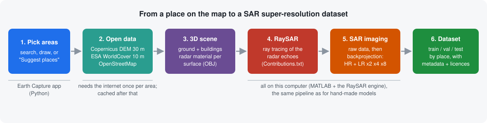

# Earth Capture

Earth Capture makes SAR images of real places. You pick areas on a world map. It downloads open data for each one, builds its 3D scene (ground, buildings, roads, water, vegetation) and runs the scene through the RaySAR pipeline in `sar_pipeline/`. You get paired high- and low-resolution SAR images, with each image's location on the Earth.

You never handle a 3D model yourself. The OBJ file of each area is built and handed to MATLAB automatically.



## Install (once)

You need:
- **Windows**, because the RaySAR engine is a Windows program.
- **MATLAB**, any recent release. No toolboxes are needed.
- **Python 3.10 or later** from python.org.
- **Blender**, optionally, to place views by hand.

```powershell
powershell -ExecutionPolicy Bypass -File earth_capture\install.ps1
```

The installer:
1. Creates `earth_capture\.venv`.
2. Installs the packages in `earth_capture/requirements.txt`.
3. Runs a check of MATLAB, Blender and the data servers.

You can run that check again at any time:

```powershell
earth_capture\.venv\Scripts\python.exe -m terrabound_earth doctor
```

## Make a dataset

Start the app:
- double-click `earth_capture\Earth Capture.bat`; or
- click **Real world (map)...** in MATLAB's SAR Dataset GUI; or
- run `python -m terrabound_earth` from `earth_capture`.

### 1. Choose an area
You can choose an area in three ways:
- **Search:** search for a place, then click a result. A square of the size in the box (500 m by default) appears on it.
- **Draw on map:** drag a rectangle on the map.
- **Square here:** a square in the middle of the map.

Drag the corner handles to resize the area, and the middle handle to move it. The card under the search box shows:
- the area's size;
- how many SAR views it will make;
- how big their images will be;
- any problem. Each side must be at least 60 m, and the whole area at most 4 km².

Give the area a name and click **Add to queue**.

### 2. Queue
- **Suggest places…** fills the queue for you. It picks random areas of a kind, inside the area shown on the map or anywhere in the world: city centre, suburb, coast or port, farmland, forest, desert, mountains, or anywhere on land. Each suggestion is checked against its land cover (and its relief, for mountains) before it is added.
- **Download data** downloads the data and builds the scenes of every waiting area. This is the only step that needs the internet; do it while you are online.
- **Make SAR images** runs everything that is not done yet: it builds any missing scene, plans the views, and runs MATLAB. It works through the queue without you. **Stop** finishes the current view and stops. Running again carries on where it stopped, because finished views are never redone.

Click an area in the queue to show what was built over the map:
- the radar materials of the ground;
- the buildings, coloured by where their height came from: red = tagged in OpenStreetMap, orange = from the number of storeys, white = typical height for the building type.

The buttons on an area are:
- **Make:** only this area.
- **Blender:** place extra views by hand (see [blender.md](blender.md)).
- **Retry:** an area whose data was unavailable.
- **Rename** and **Remove** (its files stay in `runs/`).

### 3. Results
The finished views of the selected area: the HR image and the LR ×2, ×4 and ×8 images of each view. Hover over a view to see its footprint on the map, and click an image to enlarge it. Images are shown in map orientation, as the export writes them.

### 4. Export the dataset
**Export dataset** collects every finished area into one dataset folder under `datasets/`, split into train, validation and test **by place**. See [dataset_format.md](dataset_format.md). Choose the LR layout:
- **same size as HR**: as the pipeline makes it;
- **smaller**: each LR image shrunk by its factor, the usual super-resolution layout.

## Settings

| Setting | Default | What it does |
|---|---|---|
| Resolution | 0.30 m (500 MHz) | HR resolution. The pixel is half of it. |
| Lower-resolution factors | 2 4 8 | LR images made with 1/f of the bandwidth and 1/f of the aperture. |
| Views | Random | **Random:** varied places, bearings and angles, mostly centred on buildings. **Grid:** windows that cover the whole area from each bearing in the list. |
| Views per area | 16 | Random mode. |
| Window side | 100 m | Side of the ground square each image covers. At 0.30 m, 100 m is about 670 px, within the 256–1000 px patches super-resolution models usually train on. The largest is about 285 m (2000 px). |
| Incidence | 20–50° | Angle of the radar from the vertical, drawn at random in this range for each view. Real X-band satellites image at about these angles (ICEYE 20–35°, Capella 25–50°). |

The defaults follow real X-band SAR satellites, the same band as RaySAR's 3.1 cm wavelength:
- The **HR** image (0.30 m) matches their finest spotlight modes: TerraSAR-X Staring SpotLight (0.25 m) and ICEYE Dwell Precise (0.25 m).
- The **LR** images match coarser modes:

  | LR | Resolution | Comparable modes |
  |---|---|---|
  | ×2 | 0.6 m | Capella Spotlight, ICEYE Dwell Fine |
  | ×4 | 1.2 m | ICEYE Spot, Capella Stripmap |
  | ×8 | 2.4 m | TerraSAR-X SpotLight and StripMap |

- Their scenes are kilometres across (4–5 km spotlight). Training uses patches cut from such scenes, so many places of 0.5–1 km, each with patch-sized windows, give a more varied dataset than a few large ones.
| Grid bearings | 0 90 180 270 | Grid mode. Compass direction from the scene to the radar (0 = the radar is north of the scene). |
| Seed | 1 | Makes the random views and the speckle repeatable. |
| Ground grid | 5 m | Spacing of the terrain mesh. Larger areas are coarsened automatically to stay below 600,000 ground triangles. |

## Without the app

```powershell
cd earth_capture
.venv\Scripts\python.exe -m terrabound_earth run --lat 6.9355 --lon 79.8430 --size 400 --name "Colombo Fort"
.venv\Scripts\python.exe -m terrabound_earth suggest coast --region 79.5 5.9 82.0 9.9 --n 10
.venv\Scripts\python.exe -m terrabound_earth batch places.csv        # columns: name, lat, lon[, size_m]
.venv\Scripts\python.exe -m terrabound_earth process                 # everything in the queue
.venv\Scripts\python.exe -m terrabound_earth export --lr-size native
```

## What it builds, and from what

For each area, plus a 150 m margin so that views near the edge still see their surroundings:

1. **Elevation**
   - Source: Copernicus DEM GLO-30, a 30 m surface model.
   - Resampled bicubically to the ground grid, in a local frame centred on the area (metres east and north), with the Earth's curvature included.
   - The DEM gives the tops of buildings, so in built-up areas the bare ground is recovered first: a 150 m grey-scale opening, smoothed and blended at the edges. Otherwise the buildings would be counted twice.
2. **Land cover**
   - Source: ESA WorldCover 2021, 10 m. Gives each ground cell a radar material:

     | WorldCover class | Material |
     |---|---|
     | Tree cover, shrubland, mangroves | vegetation |
     | Grassland, cropland, wetland, moss | grass |
     | Built-up | asphalt |
     | Bare ground | soil (sand where an area is mostly bare) |
     | Water | water (sea at sea level) |

   - OpenStreetMap water areas and roads are drawn on top: roads as asphalt at their width, bridges and tunnels left out.
3. **Buildings**
   - Source: OpenStreetMap outlines (and building parts) from the Overpass API, extruded as blocks (LoD1, flat roofs).
   - **Height:** the `height` tag if there is one, else `building:levels` × 3 m, else a typical height for the building type. Each building's source is kept, and the dataset metadata counts them.
   - **Material:** metal for industrial buildings and sheds, concrete otherwise.
4. **The scene:**
   - `runs/<area>/scene/<area>.obj`: metres; x east, y up, z south; one `usemtl` group per material.
   - `scene.json`: where it is, what it was made from, the attributions.

The materials are hand-set radar responses (`sar_pipeline/Scripts/Radar_Materials.m`), not measured backscatter.

## Views and orientation

- **Ground point:** each view is a square ground window on a chosen ground point. The pipeline aims at the scene's lowest point, so on raised ground the aim is moved by height × tan(incidence). That way the window lands on the chosen point. This matters in hilly areas, where the shift can be hundreds of metres.
- **Mirroring:** the pipeline's images are the left-right mirror of the map, because the scene is right-handed (as OBJ files are) and the POV-Ray engine is left-handed. The export flips them back, and so does the results gallery. The two-tower test in [pipeline.md](pipeline.md) checks this.

## Offline use, and when a service is down

Only new areas need the internet. Each area's data is downloaded once into `earth_capture/.cache`, and its scene is kept in `runs/<area>/scene`. Building it again, making more views, or exporting needs no connection. The SAR rendering is always local.

| Data | First choice | If that fails |
|---|---|---|
| Elevation and land cover | AWS Open Data | Microsoft Planetary Computer |
| OpenStreetMap | overpass-api.de | two mirror servers, with retries |

If every server fails, the area is marked **Data unavailable, retry later** and the queue moves on. **Download data** while online lets you make the images offline later.

## Limits

- **Terrain:** the 30 m DEM is smooth. Terrain detail smaller than about 100 m is not in it, and in dense cities smaller than the 150 m ground-recovery window.
- **Buildings:** flat-roofed blocks. Where OpenStreetMap has no heights (common outside Europe and North America), heights are typical values, not measurements. Unmapped buildings are missing.
- **Trees:** a rough surface material, not 3D crowns. Moving water, cars and people are not modelled.
- **Radar response:** set per material class, not measured.
- **Time:** each view takes the time of one RaySAR render plus the image formation (see [pipeline.md](pipeline.md)). Views run one after another, because the engine runs one instance at a time.
- **Size:** areas are limited to 4 km².

## Files

```
runs/
  queue.json, settings.json, locations.geojson   the queue (locations.geojson opens in any GIS)
  <area id>/
    scene/      <area>.obj, <area>.mtl, scene.json, terrain.npz, preview/
    sar/        job.json, views.json, progress.jsonl, result.json, matlab.log,
                <area id>/views/v001_r001_az123_inc45/  HR.png, LR_mid.png, LR_low.png, LR_vlow.png, sar_images.mat
    blender/    views captured in Blender (if any)
earth_capture/.cache/                            downloaded elevation, land cover and OpenStreetMap data
datasets/sar_dataset_<time>/                     exported datasets
```
