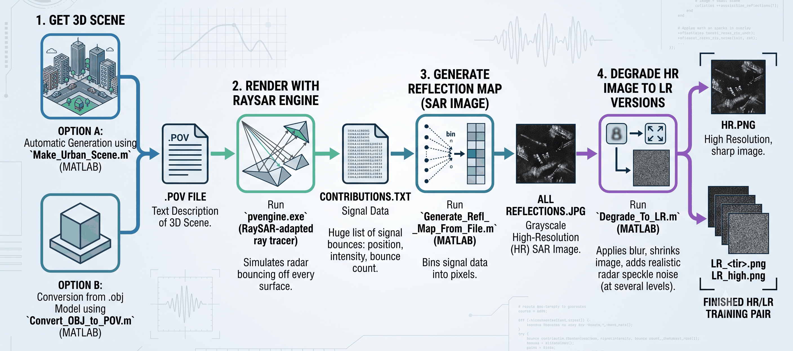
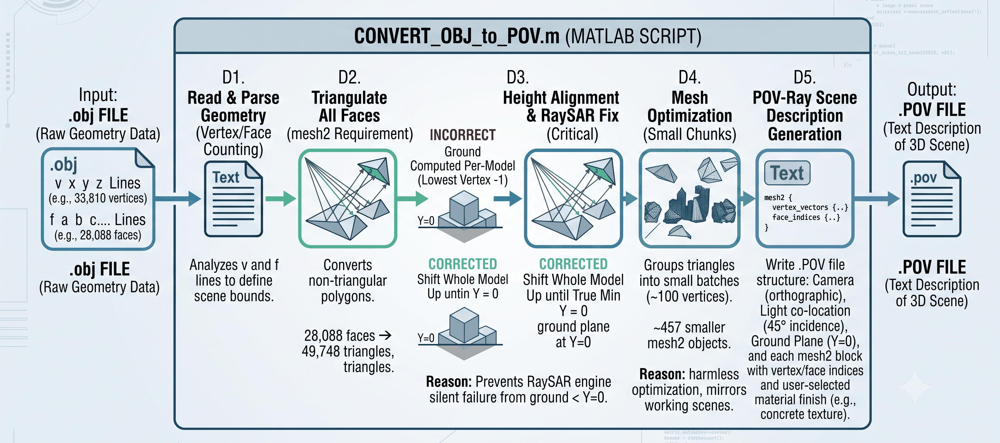
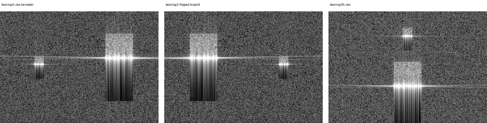

# The SAR pipeline

How `sar_pipeline/` turns a 3D scene into SAR images: the theory of each stage, how to run each one through its GUI, and how the images were checked. Making many images at once is covered in [obj_workflow.md](obj_workflow.md) (from your own 3D models), [earth_capture.md](earth_capture.md) (from real places) and [blender.md](blender.md) (views placed by hand).

Everything the pipeline needs is inside `sar_pipeline/`: the RaySAR ray-tracing engine and its support library, RaySAR's MATLAB code, and the code written on top of it. You install only MATLAB (no toolboxes) on Windows.

## Part 1. What happens in each stage

```
STAGE 1            STAGE 2              STAGE 3 / 5                 STAGE 4
Build a 3D    -->   Ray-trace it    -->  Turn the radar echoes  -->  Low-resolution
scene (.pov)        (pvengine.exe)       into an HR image            versions
                    Contributions.txt    (MATLAB)                    (MATLAB)
```



### Stage 1: build a 3D scene

A `.pov` file is a plain-text description of a 3D scene in POV-Ray's language: camera, light, ground and objects. Converting an `.obj` 3D model into one (`Convert_OBJ_to_POV.m`) works like this:



1. **Read the geometry.** An `.obj` file lists vertices (`v x y z`) and faces (`f a b c ...`). Each face's material name (`usemtl`) is kept too, for the optional radar materials (see below).
2. **Triangulate.** POV-Ray's `mesh2` takes only triangles, so larger faces are fan-triangulated.
3. **Fix the ground height.** The RaySAR engine silently produces nothing if any geometry lies below Y = 0, so the model is shifted up until its lowest point is at exactly 0.
4. **Split the mesh.** The engine also fails silently on a `mesh2` object with more than about 133 vertices. The triangles are ordered along a Morton curve over the ground plan and cut into objects of at most 100 vertices, so each object is a small patch. A view then loads only the patches it can see.
5. **Write the `.pov`.** A co-located orthographic camera and parallel light (a monostatic radar), the ground plane at Y = 0, then the mesh objects. Each object gets the radar *finish* of its surface.

**Radar materials.** A finish says how mirror-like or rough a surface is to the ray tracer:
- `diffuse` sends energy straight back (bright single bounce);
- `reflection` lets a ray go on to the next surface (double and triple bounce, such as the bright line where a wall meets the ground).

`Radar_Materials.m` holds the named finishes: concrete, metal, vegetation, grass, sand, soil, land, water, sea, asphalt. With the converter's `materials` option, each face's material name picks its finish. Without it, one finish is used for the whole mesh, exactly as before. The values are hand-set, not measured.

### Stage 2: ray-trace it

`pvengine.exe`, a build of POV-Ray 3.7 modified for RaySAR, simulates how the radar signal bounces off every surface: direct returns, ground bounces, double, triple and higher multi-bounce. It writes every signal contribution (position in azimuth, range and elevation, intensity, number of bounces) to `Contributions.txt`.

### Stage 3: the reflectivity map (RaySAR's own image)

RaySAR's `Gen_Refl_Map` bins the contributions into pixels by position and sums them: a grey-level reflectivity map. This is RaySAR's original output. It has no speckle and no sidelobes, and its "resolution" is just the pixel size you choose.

### Stage 4: low-resolution versions of the reflectivity map

`Degrade_To_LR.m` blurs the map, downsamples it, and multiplies it by Gamma-distributed speckle (L looks), at several severity tiers. It writes:
- `HR.png`;
- `LR_<tier>_native.png` (downsampled);
- `LR_<tier>_aligned.png` (scaled back up to the HR size).

### Stage 5: form the image the way a radar does (recommended)

Stages 3 and 4 stop at a reflectivity map and fake the low resolution. Stage 5 (`SAR_Imaging/`) adds the radar signal chain RaySAR leaves out. It produces images with real speckle and sidelobes, and low-resolution images made by collecting less radar data. **This is what the SAR Dataset GUI, the Blender add-on and Earth Capture all use.** See Part 4.

## Part 2. Setup

1. Install MATLAB on Windows. No toolboxes are needed. Recent releases (R2025b and later) come without Java, and the pipeline does not need it.
2. In MATLAB, go to `sar_pipeline` and put its code on the path:
   ```matlab
   cd('path/to/TerraBound-SAR/sar_pipeline')
   addpath('RaySAR', 'Scripts', 'SAR_Imaging');
   ```
3. Nothing else to install. The engine (`POV_Ray/RaySAR/pvengine.exe`), its include files and RaySAR's code are in the folder.

## Part 3. Each stage through its GUI

### Stage 1: OBJ to POV converter
```matlab
OBJ_to_POV_GUI
```
Choose the `.obj` file and a result folder, then click **Convert**. The `.pov` takes the `.obj` file's name.

### Stage 2: rendering
RaySAR's own window:
```matlab
RaySAR
```
- Set **Object Model** to the folder with your `.pov`.
- Click **Rendering** and pick the scene. `Contributions.txt` is written next to it; large scenes can take a few minutes.
- **Manual editing** opens a scene in the engine's own window. This build has no text editor, so edit `.pov` files in any text editor.

### Stage 3: reflectivity map
Same window, **2D maps**:
1. **Load Data**: the `Contributions.txt` from stage 2.
2. Set the pixel spacing and bounds (the histogram buttons help).
3. Click **Reflectivity Map**.

The clean map is `Maps/Frames/Ref_Maps/All Reflections_Fr.tif`. The `.jpg` files under `Maps/Figures` are screenshots of MATLAB figures, with axes and a colour bar, so use the `.tif` for any further processing.

### Stage 4: low-resolution versions of a map
```matlab
tiers(1) = struct('name','mid',  'scale',2, 'looks',4, 'blur_sigma',0.6);
tiers(2) = struct('name','low',  'scale',4, 'looks',2, 'blur_sigma',1.2);
tiers(3) = struct('name','vlow', 'scale',8, 'looks',1, 'blur_sigma',2.0);
Degrade_To_LR('Maps/Frames/Ref_Maps/All Reflections_Fr.tif', 'LR_Pairs', tiers);
```
`scale` is the downsampling factor, `looks` sets the speckle (1 look is the strongest), and `blur_sigma` is the blur before downsampling.

`Scripts/Sample_Scenes/Run_Reflectivity_Pipeline.m` repeats stages 3 and 4 for each sample scene with the settings they were made with. Like the original scripts, it degrades the figure `.jpg`.

### Stage 5: realistic SAR image
The **Realistic SAR image** panel on the right of the **2D maps** window forms SAR images from the loaded contributions:
- **Bandwidth [MHz]** sets the HR resolution, c / 2B: 500 MHz gives 0.30 m.
- **Lower-resolution factors**: `2 4 8` gives `LR_mid`, `LR_low` and `LR_vlow`.
- **Speckle seed**.
- **Output folder**: empty means `SAR_Results` next to the scene.

It writes `HR.png`, an `LR_<name>.png` per factor, and `sar_images.mat` (the complex images). Without the GUI:
```matlab
cd('SAR_Imaging'); run_street01_sar     % after rendering Scenes/Street_01.pov
```

## Part 4. The radar signal chain

### Why it exists

RaySAR is a *reflectivity map* simulator. It traces rays and records where the energy lands in the azimuth–range plane, but it never transmits a waveform, flies a synthetic aperture or forms an image from raw data.

| Layer | What it decides | RaySAR |
|---|---|---|
| Scattering | how much energy returns, and from where | geometric ray tracing, validated against real urban SAR |
| Imaging | how a radar turns those returns into a picture | **absent** |

Everything that makes RaySAR output look unlike real SAR (too clean, no speckle, no sidelobes) belongs to the imaging layer. This stage supplies it, following Gorham and Moore, *SAR image formation toolbox for MATLAB*, Proc. SPIE 7699 (2010), doi:10.1117/12.855375.

| From the paper | Used for |
|---|---|
| Eq. (5) signal model | what the receiver measures from each scatterer |
| Eqs. (4), (6) differential range | the geometry of each pulse, motion-compensated to the scene centre |
| Eqs. (7), (9) alias-free scene size | checking the scene fits the collection |
| Eq. (8) range resolution c/2B | how fine the image is in range |
| Eq. (10) cross-range resolution λ/(2θa) | how fine it is in azimuth |
| Eqs. (20)–(22) | the backprojection (`bpBasic.m`, Appendix A.2, used as published) |

### The chain

```
RaySAR ray tracing  ->  Contributions.txt
contributions       ->  point scatterers          Contributions_To_Scatterers.m
scatterers          ->  raw radar data            Synth_PhaseHistory.m   (Eq. 5)
raw data            ->  focused image             bpBasic.m              (Eqs. 21, 22)
less raw data       ->  genuinely coarser images  Make_HR_LR_Pairs.m
```

- **Amplitude comes from RaySAR, phase does not.** RaySAR has no propagation model, so here the phase comes from the geometry, and each scattering cell gets a random phase: the standard model of a surface rough at the wavelength scale (Goodman 1976). That phase diversity is what makes the speckle.
- **LR images are formed from less data.** The HR image uses the full bandwidth and aperture. Each LR image uses a centred subset of the same raw data: half the bandwidth and half the aperture gives twice the resolution cell. The point spread function widens and the speckle changes as they do in a real radar. All images share one pixel grid, so pairs are aligned by construction.

Defaults:
- X band, λ = 3.1 cm (RaySAR's wavelength).
- 500 MHz bandwidth (0.30 m).
- An aperture that gives the same resolution in azimuth.
- 0.15 m pixels.
- Slant range 500 km. RaySAR's camera is orthographic, so the wavefront is close to flat.

### Validation (from the original work)

| Test | Result |
|---|---|
| `test_paper_fig1.m` reproduces the paper's Figure 1 | peaks exactly on the three targets; 0.249 m range and 0.295 m cross-range resolution against 0.250 and 0.286 m predicted |
| matched filter vs backprojection | magnitude correlation 1.0000 |
| `test_forward_model.m`, fast model vs the exact Eq. (5) sum | 0.26 % relative difference, correlation 0.999997 |
| Street_01 resolution tiers achieved | 0.30, 0.60, 1.20, 2.39 m |

### What it does not fix

Scattering still comes from geometric ray tracing. There is no frequency- or material-dependent scattering beyond the hand-set finishes, no Bragg scattering (sea surfaces stay stylised), no volume scattering (forests stay surfaces), and no polarimetry.

## Part 5. Checks of this version

These checks were run in November 2026 on MATLAB R2026b. They compare this version with the previous one (the code on `main` before the Earth Capture work) and test the real-world scenes.

### Nothing in the SAR method changed

| Check | Result |
|---|---|
| Street_01 model converted without materials, old and new converter | identical `.pov` (2,581,648 bytes) and identical chunk index |
| Colombo Fort scene (real-world, with material names) converted without materials, old and new | identical `.pov` (1,881,797 bytes): the material names are ignored unless asked for |
| One Street_01 view (bearing 30°, incidence 45°, 40 m window, seed 7) through the old and the new pipeline | HR, LR ×2 and LR ×4 identical pixel for pixel; complex HR image difference exactly 0; `dataset_index.csv` identical apart from the run time |
| Resolution achieved on that view | HR 0.30 / 0.31 m, LR ×2 0.60 / 0.61 m, LR ×4 1.20 / 1.21 m (range / cross-range) |

### Radar materials

Converting the Colombo Fort scene with `materials = 'auto'` gave 346 mesh objects, at most 100 vertices each. Each object has the finish of its surface: 218 asphalt, 47 soil, 42 concrete, 26 vegetation, 11 grass, 1 water and 1 metal, plus the ground plane.

### Image orientation (two-tower test)

The test scene has a big tower (24 × 24 m, 30 m tall) in the west and a small one (8 × 8 m, 10 m tall) in the east, on flat ground.



- **Seen from the north (bearing 0):**
  - The big western tower comes out on the **right** of the image as made. The pipeline's images are therefore the left-right mirror of the map: the scene is right-handed, the POV-Ray engine left-handed.
  - Flipped (middle), it is on the left, as on the map. Earth Capture's export and gallery apply this flip.
- **Seen from the east (bearing 90):** the near (eastern) tower is at the top and the far one lower down, so near range is at the top as documented. Range needs no correction.
- **Both views** show what a SAR image of a tower should:
  - layover towards near range;
  - the bright double-bounce line where the wall meets the ground, with its azimuth sidelobes;
  - the radar shadow behind.

### Run times

Measured on this computer:
- one 40 m Street_01 view: about 50 s, render plus all images;
- two 140 m two-tower views at 0.5 m: 235 s.

Most of the time goes into backprojection, which grows with the number of image pixels times the number of pulses. Plan on one to three minutes per view at 0.30 m with 150 m windows.
